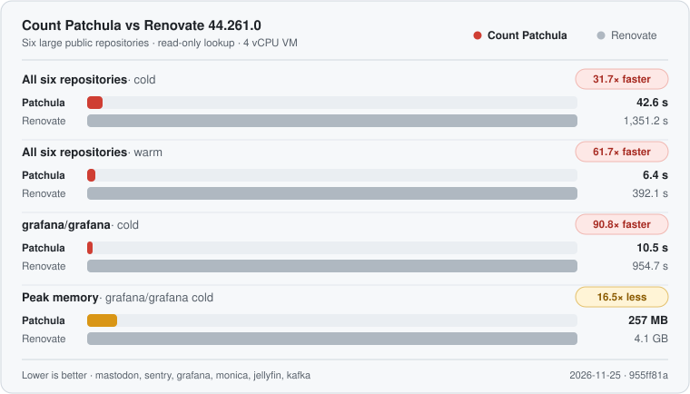

<div align="center">
  
  <h1>Count Patchula</h1>
  <p><strong>Count Patchula vants to update your deps. He never sleeps. Neither do your CVEs.</strong></p>
  <p>A modern dependency updater with strong defaults.</p>
  <p>
    <a href="https://count-patchula.sweepy.dev/getting-started/">Get started</a> ·
    <a href="https://count-patchula.sweepy.dev">Documentation</a> ·
    <a href="https://count-patchula.sweepy.dev/renovate/compatibility/">Coming from Renovate</a> ·
    <a href="https://count-patchula.sweepy.dev/benchmarks/">Benchmarks</a>
  </p>
</div>

The Count reads your repositories' manifests through the GitHub API, looks up
newer versions, and opens one pull request per update with regenerated lockfiles
and release notes. One native binary handles the whole batch: repositories run
concurrently, and every package is looked up once however many repositories use
it.

## Benchmarks

<picture>
  <source media="(prefers-color-scheme: dark)" srcset="assets/benchmarks-dark.svg">
  <source media="(prefers-color-scheme: light)" srcset="assets/benchmarks-light.svg">
  
</picture>

Measured against Renovate 44.261.0 on six large public repositories, looking up
updates without writing, each tool alone on the same 4 vCPU VM. See the
[benchmarks page](https://count-patchula.sweepy.dev/benchmarks/) for the full
method, coverage and notes.

<details>
<summary>Per-repository breakdown (wall time &amp; peak memory)</summary>

| Repository | Patchula cold | Patchula warm | Renovate cold | Renovate warm | Cold speedup |
|---|---:|---:|---:|---:|---:|
| `mastodon/mastodon` | **9.7 s**, 195 MB | **1.0 s**, 69 MB | 152.6 s, 2.0 GB | 134.2 s, 905 MB | **15.8×** |
| `getsentry/sentry` | **8.3 s**, 124 MB | **1.2 s**, 67 MB | 104.5 s, 2.0 GB | 60.4 s, 1.1 GB | **12.7×** |
| `grafana/grafana` | **10.5 s**, 257 MB | **1.8 s**, 163 MB | 954.7 s, 4.1 GB | 95.3 s, 2.1 GB | **90.8×** |
| `monicahq/monica` | **3.4 s**, 72 MB | **0.7 s**, 42 MB | 44.6 s, 911 MB | 35.3 s, 637 MB | **13.0×** |
| `jellyfin/jellyfin` | **5.5 s**, 51 MB | **0.9 s**, 38 MB | 30.9 s, 763 MB | 29.0 s, 689 MB | **5.6×** |
| `apache/kafka` | **5.2 s**, 56 MB | **0.8 s**, 39 MB | 64.0 s, 1.2 GB | 37.9 s, 880 MB | **12.2×** |
| **Total** | **42.6 s** | **6.4 s** | **1,351.2 s** | **392.1 s** | **31.7×** |

</details>

## What you get

- **Broad ecosystem coverage** — 30 built-in
  [managers](https://count-patchula.sweepy.dev/guide/managers/) across
  application packages, containers, Kubernetes, infrastructure, CI workflows
  and custom regex extractors, all on by default.
- **Real lockfiles, regenerated fast** — Committed
  [lockfiles](https://count-patchula.sweepy.dev/guide/lockfiles/) are rebuilt
  with each ecosystem's real tool without running repository or install
  scripts. JavaScript locks (npm, pnpm, Yarn Classic, `aube-lock.yaml`) go
  through [aube](https://aube.sh), 10–30× faster than the stock package
  managers.
- **Typed configuration** — Policy is written in [Pkl](https://pkl-lang.org)
  against a published schema, so a typo is an error with a file and line number
  rather than a silently ignored key.
- **Careful defaults** — Exact pins or locked ranges, digest-pinned actions and
  container images, a 24-hour release-age wait, verified GitHub-signed commits,
  and auto-merge off by default (beyond reference data such as CA bundles).
- **Security fixes first** — Every dependency with an exact version is checked
  against [OSV.dev](https://osv.dev); fixes skip release-age waits, schedule
  windows and PR limits.
- **Dashboard & batching** — A [dependency
  dashboard](https://count-patchula.sweepy.dev/guide/dashboard/), schedule
  windows, PR limits, grouping, auto-merge behind check gates, and a
  [batch PR](https://count-patchula.sweepy.dev/guide/batch/) you fill by
  ticking a box on any update PR or on the dashboard while keeping the exact
  versions you reviewed.
- **MIT-licensed GitHub App server** — Webhooks, scheduled sweeps, a priority
  queue, multiple installations, warm shared caches and a JSON reporting API in
  the same binary—no paid enterprise tier required.
- **Local CLI & TUI** — Browse and selectively apply updates in a checkout with
  `patchula tui`, automate them with `patchula apply`, or trigger server runs
  from your terminal with `patchula remote run`.

## Get started

```sh
mise use -g --minimum-release-age 0 packslip:sweepies/count-patchula
```

Other ways to install him are on the [installation page](https://count-patchula.sweepy.dev/installation/).

Invite the Count into a repository with `patchula.pkl`:

```pkl
amends "PatchulaConfig.pkl"
```

That is a complete config: every default applies, including a dependency
dashboard issue. Then, with a GitHub App installation token in `PATCHULA_TOKEN`:

```sh
patchula run --dry-run acme/my-app   # look first
patchula run acme/my-app             # then let him bite
```

Lockfile tools, and the versions of the tools in `mise.toml`, come from
[mise](https://mise.jdx.dev), so it needs to be on the `PATH`, or
[packslip](https://packslip.dev) to install the Count's own pinned mise. See
[getting started](https://count-patchula.sweepy.dev/getting-started/).

The CLI is the quickest way to try him, and the [GitHub
Action](https://count-patchula.sweepy.dev/guide/github-actions/) runs him on a
schedule. The recommended way to run him is the [GitHub App
server](https://count-patchula.sweepy.dev/guide/server/): one long-running
process keeps every cache warm, batches work across repositories, and acts on
PR checkboxes the moment you tick them. It idles cheaply between batches, so
usage-billed hosts such as Railway suit it well. Each release publishes it as
a [container image](https://count-patchula.sweepy.dev/guide/server/#container-image),
`ghcr.io/sweepies/count-patchula`, for linux/amd64 and linux/arm64. Once it is up, `patchula remote
run` runs on it from your machine, signed in with GitHub, with no
token or toolchain of your own.

## Coming from Renovate

The [compatibility matrix](https://count-patchula.sweepy.dev/renovate/compatibility/)
lists every manager, datasource and feature, and [migrating a
config](https://count-patchula.sweepy.dev/renovate/migrating/) maps
`renovate.json` options onto Pkl.

## Development

Install [mise](https://mise.jdx.dev), then `mise trust` and `mise install`.

```sh
mise run build          # build the workspace
mise run test           # offline tests, including the real lockfile tool tests
mise run lint           # every hk check, Clippy (warnings denied) included
mise run hooks:install  # the pre-commit hook
mise run ci             # every check CI runs, in parallel
mise run docs:dev       # the documentation site for this checkout
```

Builds go through [mr boxington](https://mr-boxington.jdx.dev) for a shared
Cargo cache. Tests never touch the network: they replay HTTP fixtures the Count
recorded himself. Tools only the tests need, like the lockfile engines, are
task-scoped, so a plain `mise install` does not fetch them.

Count Patchula is an independent project under the MIT licence.

## Thanks

Count Patchula would not exist without [@jdx](https://github.com/jdx). His
work inspired it, and it is built on his tools at every step:
[mise](https://mise.jdx.dev) installs every toolchain and lockfile engine,
[aube](https://aube.sh) writes the npm, pnpm, Yarn Classic and aube locks,
[mr boxington](https://mr-boxington.jdx.dev) caches the builds,
[usage](https://usage.jdx.dev) generates the CLI reference and completions,
[tak](https://github.com/jdx/tak) runs the benchmarks,
[communique](https://communique.jdx.dev) writes the release notes, and
[packslip](https://packslip.dev) signs the releases. Thank you, Jeff.

## License

MIT
