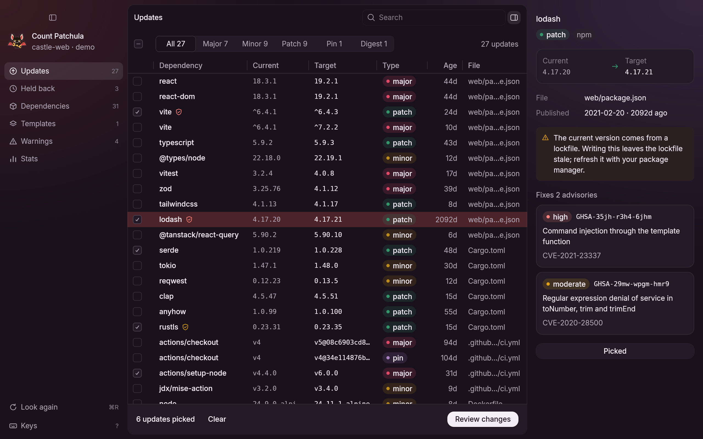
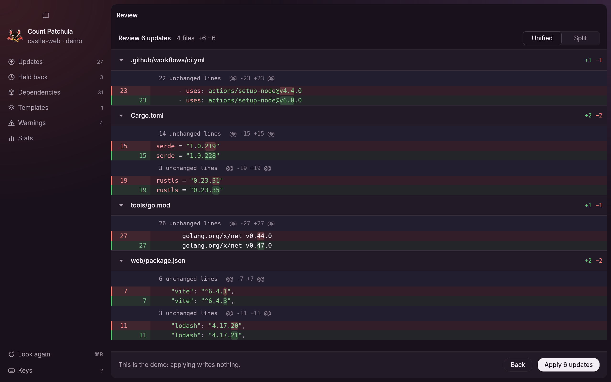
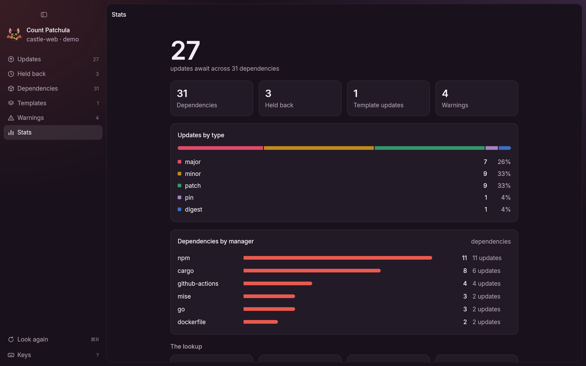

`patchula-gui` shows a lookup in a native window: the same six lists as the
[terminal UI](/guide/tui/), with a search field, an inspector for the update
under the cursor, and a diff to read before anything is written. In a checkout
it writes the updates you pick.



It is a separate program that runs the `patchula` on your `PATH`: every lookup
is `patchula lookup --json` and every write is `patchula apply --json`. The
window holds no token, makes no request and edits no file itself, so what it
shows and writes is what the CLI would.

It is not in a release yet. Build it from a checkout of the repository.

## Build and run

The window is drawn with [Rune](https://github.com/anomalyco/rune), a GPU UI
framework, and lives in its own Cargo workspace under `gui/` so that none of
that reaches the `patchula` binary.

```sh
mise run gui:build                    # gui/target/release/patchula-gui
mise run gui:run -- --demo            # open it on a made-up report
```

The first build downloads Rune's Git repository, about 160 MB, before it
compiles anything; on a slow connection that takes several minutes.

On Linux the build links `libxkbcommon` and `libwayland-client`: install
`libxkbcommon-dev` and `libwayland-dev` (Debian and Ubuntu) first, which
`mise run gui:deps` does. macOS needs nothing more than Rust. Windows is
untested.

```sh
patchula-gui                          # the working tree here; picks can be written
patchula-gui --dir ~/code/my-app      # the working tree there
patchula-gui acme/my-app acme/api     # GitHub repositories, for looking
patchula-gui --report report.json     # a report saved from `patchula lookup --json`
patchula-gui --demo                   # a made-up report, to look around
```

| Flag | Does |
|---|---|
| `--dir DIR` | Look up and write the working tree in `DIR` instead of the current directory. |
| `--report FILE` | Show a report saved from `patchula lookup --json`. Nothing can be written. |
| `--demo` | Show a made-up report. Applying writes nothing. |
| `--patchula BIN` | Run this binary instead of the `patchula` on `PATH`; also `PATCHULA_BIN`. |

Repositories and the flags of [`lookup`](/reference/cli/#patchula-lookup)
(`--cache`, `--settings`, `--concurrency`, `--config`, `--default-config`,
`--config-dir`, `--all-repos`, `--remote`) pass through to it.

A working tree is looked up on this machine, as `apply` will look it up
again, unless you pass `--remote`. In a checkout with no `patchula.pkl` the
window offers the Count's defaults, which is `--default-config` for as long as
it is open.

## Pages

| Page | Shows |
|---|---|
| Updates | every proposed update, with a box to pick it; the inspector shows the selected one's package, versions, digest, publication date and the advisories it fixes |
| Held back | releases still inside the release-age wait, with how far through it each is |
| Dependencies | everything the Count found, with how many updates and held-back releases each has |
| Templates | template updates the Count reports but never edits, with the copier command to copy |
| Warnings | lookup failures, warnings and newer releases he did not propose |
| Stats | counts, updates by type, dependencies by manager, requests and the time each phase took |

The search field filters the first three by name, package, file and manager.
A column header sorts its table.

## Picking and applying

Tick an update's box, or press `Space` on its row. **Review changes** then
runs `patchula apply --dry-run` for the picks and shows the diff it answers
with. Nothing has been written at this point.



**Apply** runs the same command without `--dry-run`. Only the working tree can
be written, with the same edits as
[`patchula apply`](/guide/apply/#what-gets-written); lockfiles are not
regenerated. An update that cannot be written in place is listed with its
reason and does not stop the rest. For GitHub repositories, a saved report
and `--remote` the window is for looking, and says why.

`patchula apply` picks updates by manager, name and type, not one by one. The
window passes it the fewest filters that take exactly your picks. When two
files declare the same dependency and you pick only one, no filter can tell
them apart: the review says so above the diff, and the diff shows both, since
both would be written.

## Stats



## Keys

The window answers the terminal UI's keys where it has the same thing to do.

| Key | Action |
|---|---|
| `1` to `6` | jump to a page |
| `/`, `Cmd-F` | search |
| `j`, `k`, `↓`, `↑` | move through the rows |
| `t` | on Updates, cycle the type filter: all, major, minor, patch, pin, digest |
| `Space` | on Updates, pick or put back the update under the cursor |
| `a` | on Updates, pick every update shown, or clear them if all are picked |
| `w` | on Updates, review what the picks would write |
| `Cmd-Return` | in the review, apply |
| `j`, `k`, `]`, `[` | in the review, next and previous change, next and previous file |
| `Esc` | leave the review, clear the search, close the keys sheet |
| `Cmd-R` | look again |
| `Shift-Cmd-B`, `Option-Cmd-I` | show or hide the sidebar and the inspector |
| `?` | show the keys |

`Cmd` is `Ctrl` on Linux and Windows.

To write updates without picking them, in a script or a pre-commit hook, use
[`patchula apply`](/guide/apply/).
